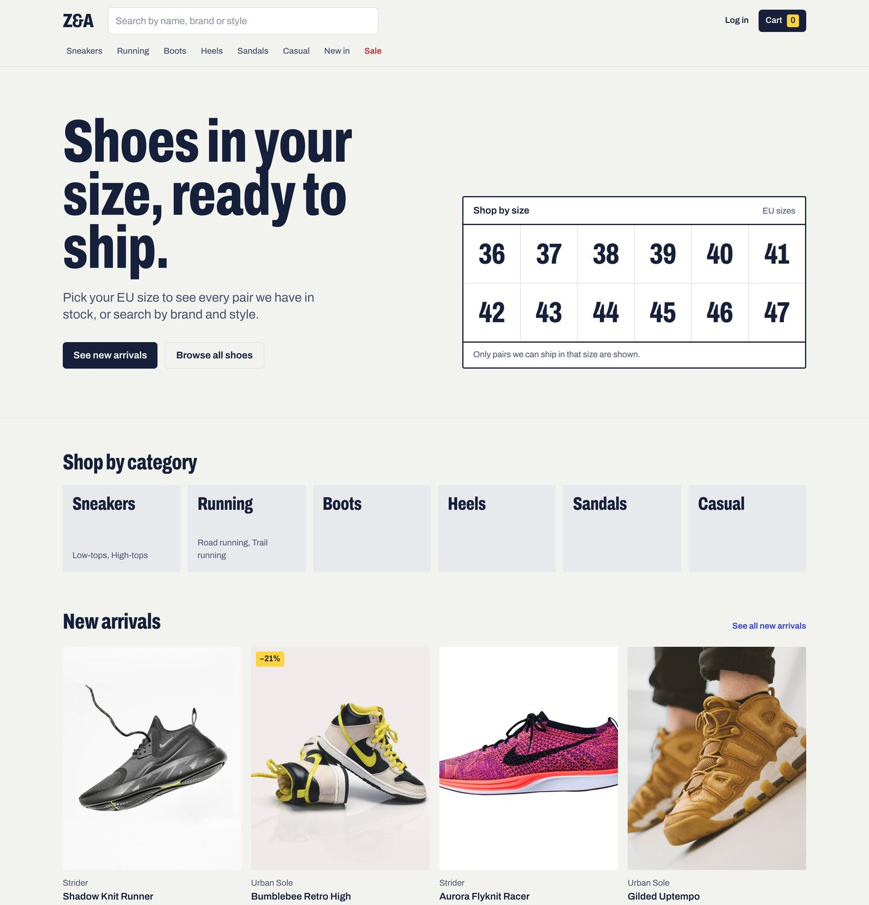
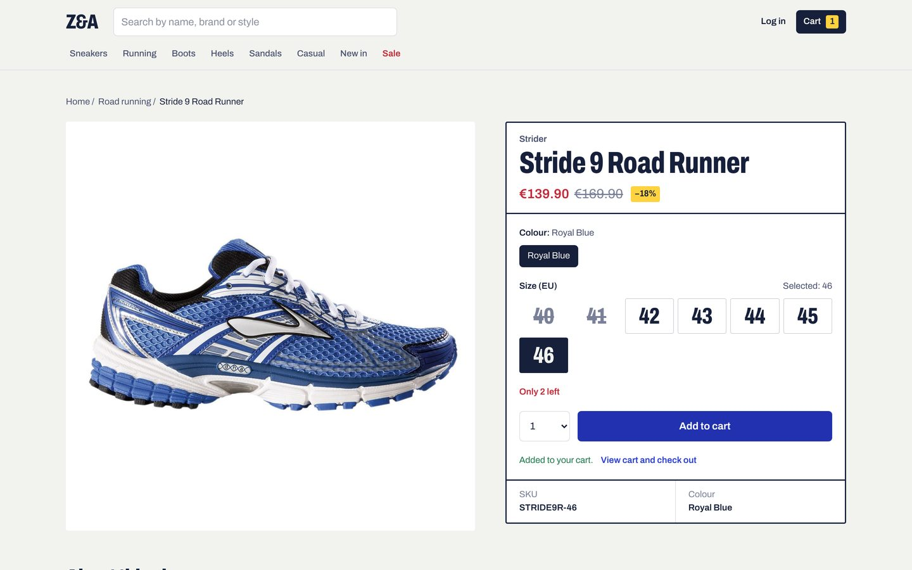
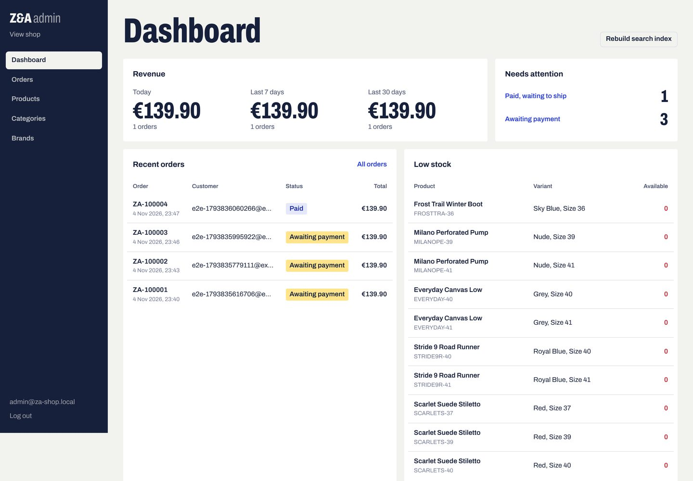
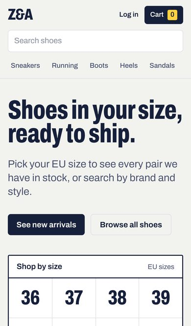
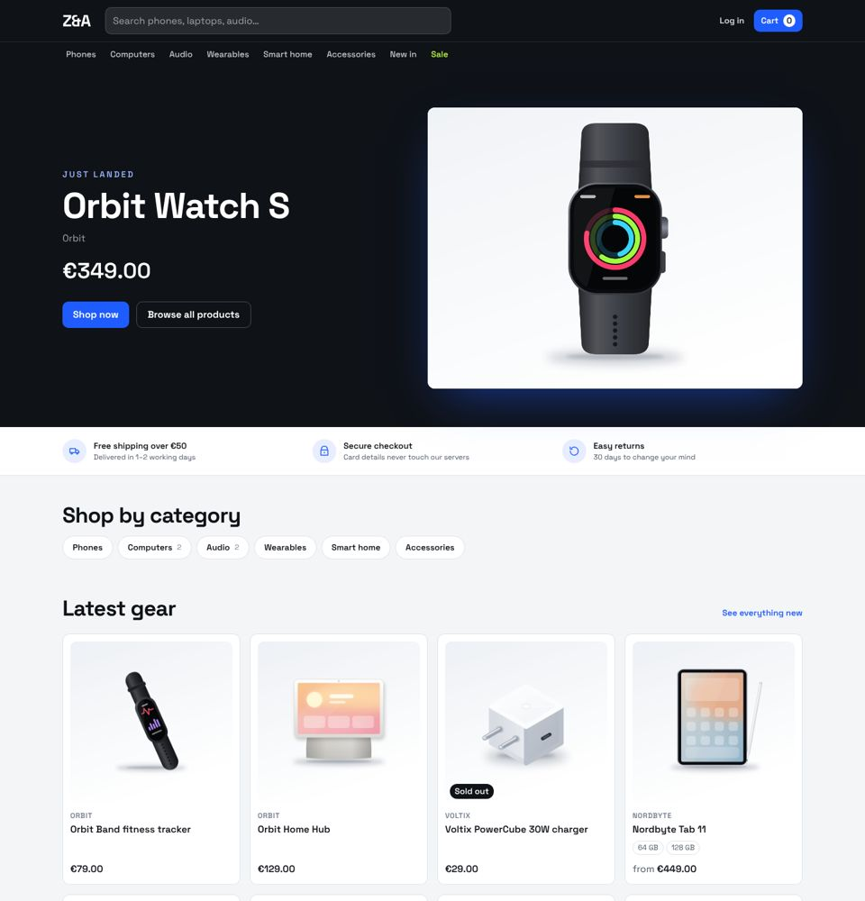
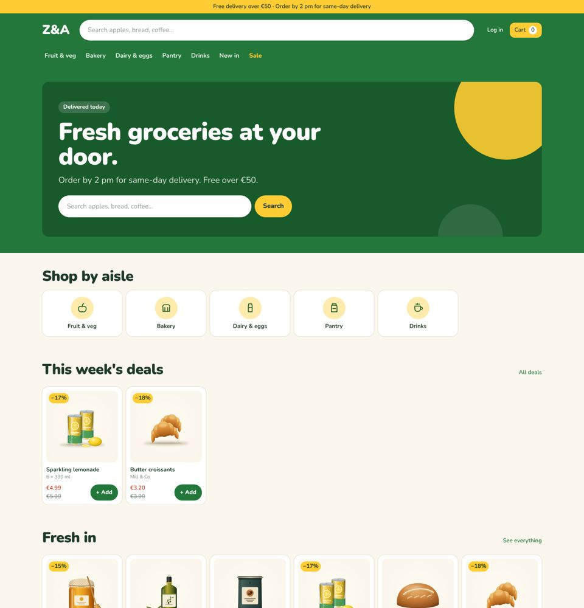
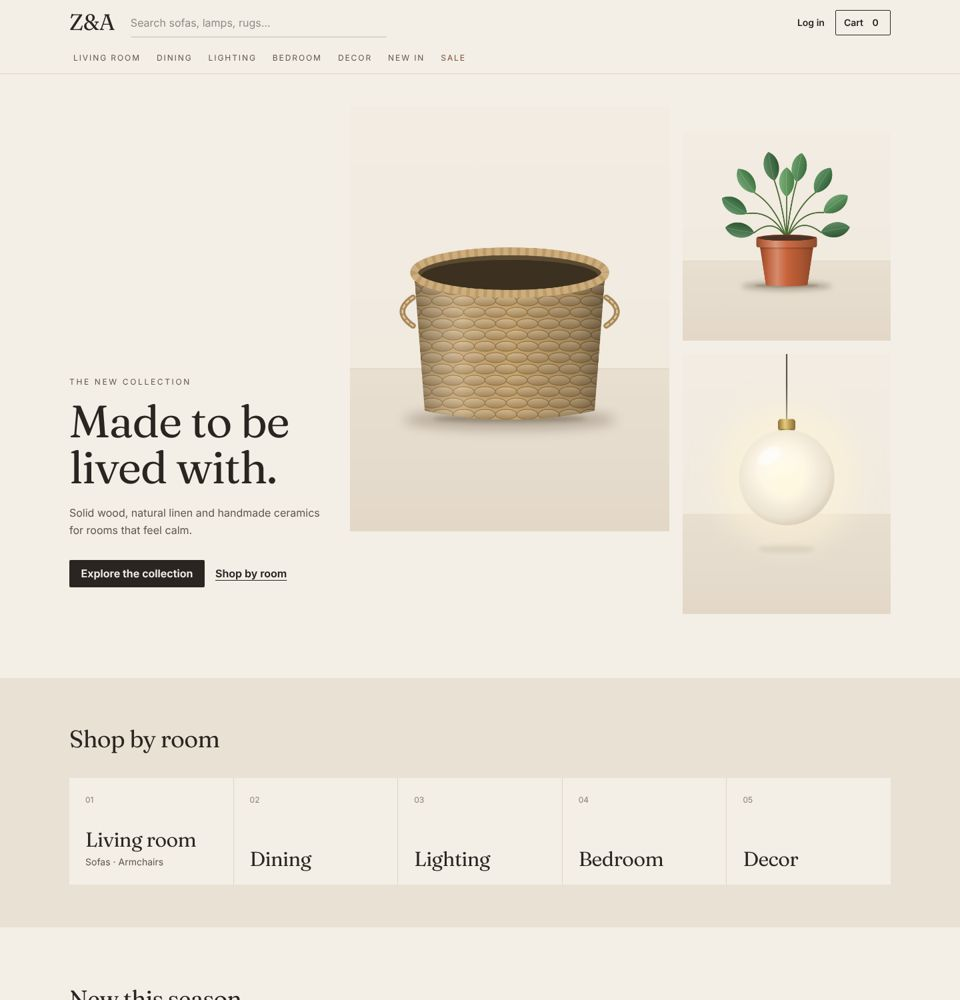
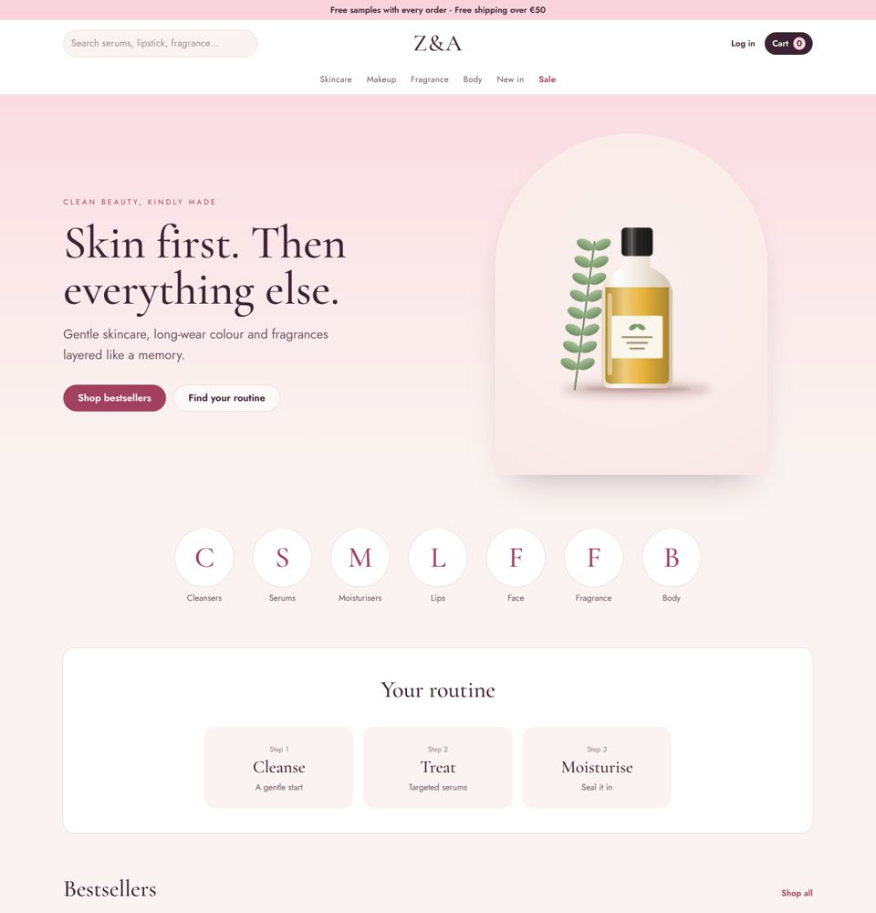
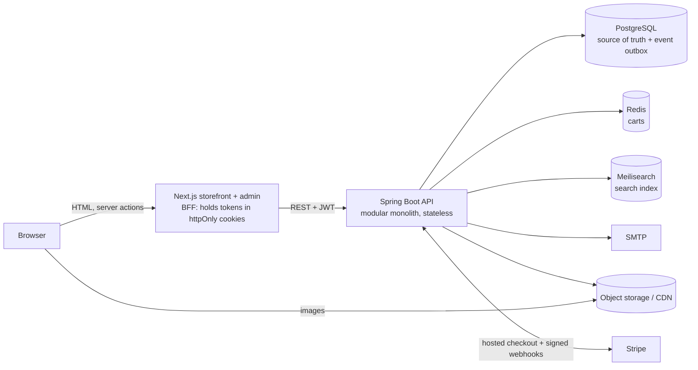

# Z&A Shop

A headless e-commerce platform: a **Spring Boot 4 API** (Java 21) and a **Next.js 16 storefront with an admin dashboard**. It's built as a modular monolith that can scale out horizontally, the same path Shopify took before splitting anything into separate services.

The storefront comes with **five designs for different kinds of shops**: footwear, electronics, grocery, home & furniture, and beauty. Admins switch between them live, with no redeploy. Each design has a matching demo catalog.



| Product page | Admin dashboard | Mobile |
|---|---|---|
|  |  |  |

## What it does

**Shoppers**
- Browse by category tree and brand, with full-text, typo-tolerant search.
- Filter by facets: brand, category, size, colour, price, in stock, on sale. Facets are disjunctive, so ticking one brand still shows the counts for the others.
- Product pages with size/colour variants, live stock, and sale prices shown struck through.
- A guest cart that follows you when you log in or register.
- Checkout with a shipping address and server-side pricing. Stock is reserved atomically, so the last pair can't be sold twice.
- Payment through **Stripe Checkout**, or a built-in test payment page for development.
- Order history and status, plus email verification and order confirmation and shipping emails.

**Shop staff** (`/admin`)
- A dashboard with revenue, orders to ship, unpaid orders, low stock and recent orders.
- Products: create and edit them, with variants (SKU, size, colour, price, compare-at price), stock levels, image upload, draft/active/archived status, and categories and brands.
- Orders: search and filter them, and move each one through paid → shipped → delivered or cancel an unpaid one.
- Rebuild the search index without downtime.

## Shop designs

| Design | Built for | Look |
|---|---|---|
| `footwear` | shoes and apparel | bold condensed type, size grid, square product shots |
| `electronics` | gadgets and tech | graphite header, electric blue, product spotlight, capacity chips |
| `grocery` | food and everyday items | fresh green, rounded type, aisle tiles, one-tap "Add" on every card |
| `home` | furniture and decor | warm neutrals, editorial serif, large imagery, finish swatches |
| `beauty` | cosmetics and fragrance | soft blush palette, elegant serif, shade swatches, routine strip |

| Electronics | Grocery | Home | Beauty |
|---|---|---|---|
|  |  |  |  |

- **Switching:** under **Admin → Design**, pick a design, set the shop name, tagline and accent colour, and upload a logo. The storefront switches on the next page load.
- **What changes:** colours, fonts, header, home page layout, product cards and how variant options are labelled (Size, Capacity, Pack size, Finish or Shade).
- **What doesn't:** the backend, checkout, admin and data stay the same.

To try a design with its matching demo products, start from an empty database:

```bash
docker compose down -v
```

```bash
SHOP_DEMO_CATALOG=grocery docker compose up --build
```

The catalogs are `footwear` (the default), `electronics`, `grocery`, `home` and `beauty`; see [docs/demo-catalogs.md](docs/demo-catalogs.md).

## Quick start

Requirements: Docker with Compose v2.

```bash
docker compose up --build
```

| What | URL | Login |
|---|---|---|
| Shop | http://localhost:3000 | `customer@za-shop.local` / `customer12345`, or register |
| Admin | http://localhost:3000/admin | `admin@za-shop.local` / `admin12345` |
| API docs (Swagger UI) | http://localhost:8080/swagger-ui.html | |
| Emails sent by the shop | http://localhost:8025 | |
| Object storage console | http://localhost:9001 | `shopdev` / `shopdev-secret-key` |

On first start the backend creates the admin account and seeds a demo catalog with fictional brands (shoes unless you set `SHOP_DEMO_CATALOG`).

To override passwords and keys, copy `.env.example` to `.env`.

## Architecture



- **Stateless API.** Logins are short-lived RS256 JWTs plus rotating refresh tokens. A replayed refresh token revokes the whole session. Carts live in Redis, so any number of API instances can run behind a load balancer.
- **BFF storefront.** The browser never sees an access token. The Next.js server keeps the tokens in httpOnly cookies and calls the API server-side. Catalog pages are cached and revalidated every 60s.
- **Modular monolith.** There are eleven modules: `identity`, `catalog`, `media`, `inventory`, `search`, `cart`, `orders`, `payments`, `notifications`, `backoffice` and `settings` (shop name and design). Each exposes a small public API and hides its internals, and `ModularityTests` fails the build if a module reaches into another or if modules form a cycle.
- **Reliable events.** Search indexing, emails and payment outcomes flow as domain events stored in PostgreSQL (Spring Modulith's transactional outbox). If Meilisearch or the mail server is down, the work waits and is retried; it is never lost.
- **Correct under concurrency.** A stock reservation is a single conditional `UPDATE` (`on_hand - reserved >= qty`). A test fires 40 parallel reservations at 5 units of stock and exactly 5 succeed.

More detail, including the checkout sequence and the scaling roadmap, is in [docs/architecture.md](docs/architecture.md). The API contract is in [docs/api.md](docs/api.md).

## Repository layout

```
backend/      Spring Boot API (Maven): src/main/java/com/za/shop/<module>
storefront/   Next.js storefront and /admin (App Router, TypeScript, Tailwind CSS)
docs/         API contract, architecture notes, screenshots
docker-compose.yml, .github/workflows/ci.yml
```

## Local development

Start only the infrastructure, then run the apps from your IDE or terminal:

```bash
docker compose up postgres redis meilisearch storage mailpit
```

```bash
cd backend && ./mvnw spring-boot:run
```

```bash
cd storefront && npm install && npm run dev
```

Without `MEDIA_PROVIDER=s3`, the backend stores images on local disk under `backend/data/media`. Its defaults in `application.yml` point at the Compose ports.

### Tests

```bash
cd backend && ./mvnw verify
```

```bash
cd storefront && npm run lint && npm run typecheck && npm test && npm run build
```

The backend tests start real PostgreSQL, Redis and Meilisearch containers (Testcontainers), so Docker must be running. They cover:
- registration, login, refresh-token rotation and reuse detection
- catalog validation and image processing
- search filters and facets
- the full checkout and payment flow
- oversell protection under concurrency
- Stripe webhook signatures and amount checks
- expiry of unpaid orders
- module boundaries

CI (`.github/workflows/ci.yml`) runs all of this on every push and pull request, then builds the Docker images.

## Configuration

Everything is set with environment variables. The most important ones:

| Variable | Default | Purpose |
|---|---|---|
| `DATABASE_URL`, `DATABASE_USER`, `DATABASE_PASSWORD` | local Postgres | PostgreSQL connection |
| `REDIS_URL` | `redis://localhost:6379` | carts |
| `MEILISEARCH_URL`, `MEILISEARCH_API_KEY` | local | search engine |
| `MEDIA_PROVIDER` | `local` | `s3` for any S3-compatible store (AWS S3, Cloudflare R2, RustFS, MinIO…) |
| `S3_ENDPOINT`, `S3_BUCKET`, `S3_ACCESS_KEY`, `S3_SECRET_KEY` | | object storage |
| `MEDIA_PUBLIC_BASE_URL` | | public URL images are served from (your CDN) |
| `STOREFRONT_URL` | `http://localhost:3000` | links in emails and payment redirects |
| `PAYMENT_PROVIDER` | `fake` | `stripe` for real payments |
| `STRIPE_SECRET_KEY`, `STRIPE_WEBHOOK_SECRET` | | Stripe API key and webhook signing secret |
| `JWT_PRIVATE_KEY_LOCATION`, `JWT_PUBLIC_KEY_LOCATION` | generated | RSA key pair shared by all API instances |
| `SHOP_ADMIN_EMAIL`, `SHOP_ADMIN_PASSWORD` | demo values | first admin account |
| `SEED_DEMO_DATA` | `true` | seed demo products into an empty catalog |
| `SHOP_DEMO_CATALOG` | `footwear` | which demo catalog to seed, and the initial design |
| `SHOP_NAME` | `Z&A` | initial shop name (editable in Admin → Design) |
| `API_URL` (storefront) | `http://localhost:8080` | API as reached from the Next.js server |

### Stripe

1. Set `PAYMENT_PROVIDER=stripe` and `STRIPE_SECRET_KEY=sk_test_…`.
2. Forward webhooks while developing:

```bash
stripe listen --forward-to localhost:8080/api/v1/payments/stripe/webhook
```

3. Put the printed `whsec_…` value in `STRIPE_WEBHOOK_SECRET`.

Orders become paid only when Stripe's signed webhook arrives and the amount matches.

### Production checklist

- Generate a JWT key pair once and give it to every API instance:

```bash
openssl genpkey -algorithm RSA -pkeyopt rsa_keygen_bits:2048 -out jwt-private.pem
```

```bash
openssl rsa -in jwt-private.pem -pubout -out jwt-public.pem
```

  Then set `JWT_PRIVATE_KEY_LOCATION=file:/run/secrets/jwt-private.pem` (and the public key) from your secret store.
- Use managed PostgreSQL (with backups and a read replica later), managed Redis, Meilisearch Cloud or a dedicated node, S3 and a CDN for images.
- Change every default password, set `SEED_DEMO_DATA=false`, and serve everything over HTTPS (`COOKIE_SECURE` defaults to on in production).
- Expose only port 8080 of the API publicly. Port 8081 (health and Prometheus metrics) is for your cluster's probes and monitoring.
- Logs are JSON (ECS format) when `LOGGING_STRUCTURED_FORMAT_CONSOLE=ecs`.

## History

This project began as a server-rendered Spring Boot 3 + Thymeleaf + MySQL shop (commit `8a3bd6a`). It was rebuilt into this headless architecture.

The footwear demo photos come from that original version. The electronics, grocery, home and beauty images are original illustrations made for this project.
