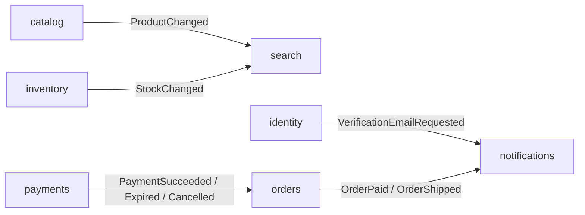
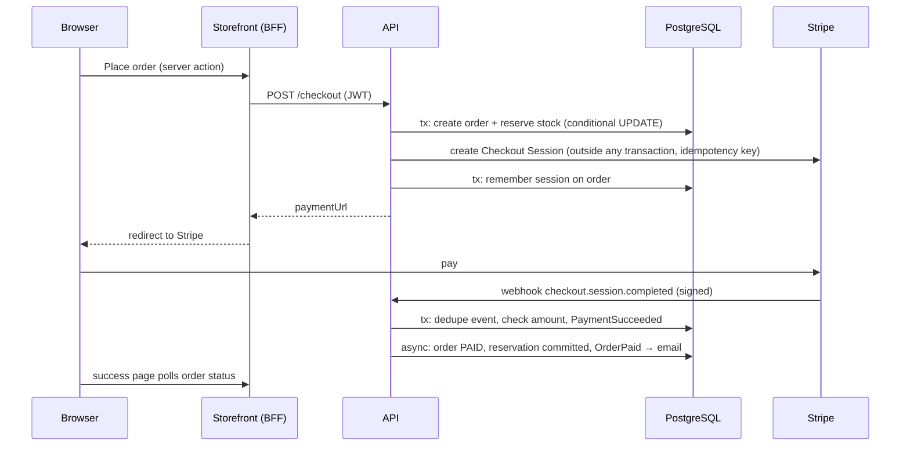

# Architecture

## Modules

The backend is one deployable, split into modules: direct sub-packages of `com.za.shop`. A module's base package is its public API; everything under `internal` is private to it. `ModularityTests` (Spring Modulith) fails the build if those rules are broken or if modules depend on each other in a cycle. That is what keeps the option open to move a module into its own service later.

| Module | Owns | Public API used by others |
|---|---|---|
| `shared` | money, paging, errors, current user | everything (open module) |
| `identity` | users, roles, JWT and refresh tokens, email verification, security rules | `VerificationEmailRequested` event |
| `media` | object storage, image validation and resizing | `MediaStorage`, `ImageProcessor` |
| `inventory` | stock per variant, reservations | `InventoryService`, `StockChanged` event |
| `catalog` | products, variants, images, categories, brands | `CatalogLookup`, `ProductChanged` event |
| `search` | Meilisearch index and product search | – (listens to catalog and inventory events) |
| `cart` | carts in Redis | `CartService` |
| `orders` | checkout, orders and their state machine, expiry | `OrderStatistics`, `OrderEvents` |
| `payments` | payment sessions, Stripe, test provider, webhooks | `PaymentService`, `PaymentEvents` |
| `notifications` | transactional emails | – (listens to identity and orders events) |
| `backoffice` | admin dashboard | – |

Each module keeps its tables to itself. No foreign keys cross module boundaries (see `V1__initial_schema.sql`).

## Events and consistency

Modules publish domain events inside their database transaction. Spring Modulith stores each event in the `event_publication` table in the same transaction (a transactional outbox) and delivers it asynchronously after commit. If a listener fails, for example because Meilisearch is down, the publication stays incomplete and is retried on restart. So read models (search index, emails) are **eventually consistent**, while PostgreSQL stays the single source of truth.

## Checkout

- Prices are always computed on the server from the catalog, never taken from the client.
- An order holds its stock for 30 minutes. A scheduled job (using `FOR UPDATE SKIP LOCKED`, so it is safe on many instances at once) cancels unpaid orders and releases their stock. If a payment arrives after expiry, the stock is reserved again when it is still available; otherwise the order is logged for a refund.
- Webhooks are verified by signature, de-duplicated by event id and amount-checked.

## Why it scales

- **Stateless API instances:** no HTTP session, JWT auth, carts in Redis, background jobs coordinated through the database. Add instances behind a load balancer.
- **Reads are cheap:** catalog and search responses carry `Cache-Control` with `stale-while-revalidate`, so a CDN and the storefront's cache absorb most traffic. Search is served entirely from Meilisearch, and product images come from object storage via the CDN.
- **Writes are short:** each request is one small transaction; slow external calls (Stripe) run outside transactions. Virtual threads (Java 21) keep thousands of concurrent requests cheap.
- **Lazy loading in batches:** entity associations are lazy and fetched in batches, never "load every product with every image".

## Scaling roadmap

1. **Now:** two or more API instances, managed PostgreSQL, Redis and Meilisearch, CDN in front of storefront and images.
2. **Bigger catalog and traffic:** PostgreSQL read replica for back-office queries, Redis cluster, a dedicated Meilisearch node (or OpenSearch behind the same `search` module), rate limiting at the edge.
3. **Team or traffic split:** publish the outbox events to Kafka (Spring Modulith event externalization) and extract the busiest module, typically `search` or `orders`, into its own service with its own database. The module boundaries and the "no cross-module foreign keys" rule make this a move, not a rewrite.
4. **Next features:** coupons and promotions, tax rules per country, multi-currency, customer addresses and wishlists, refunds through Stripe, returns, product reviews, analytics events.
